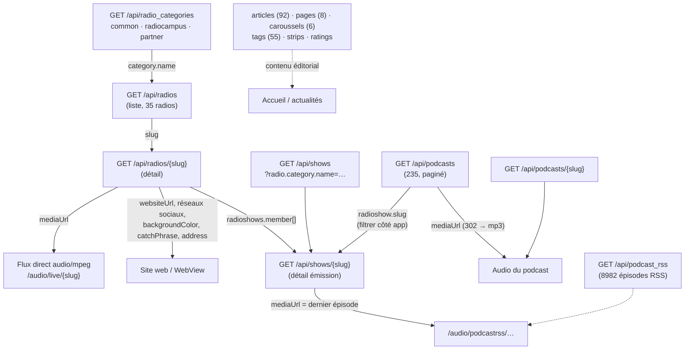

# API Radio Campus — schéma

Base : `https://api.radiocampus.org/api` · publique, sans authentification · lecture seule (GET testés).
Toujours envoyer `Accept: application/ld+json` (sinon 404 sur certains formats). Réponse en UTF-8.

## Fonctionnement général

## Ressources

| Endpoint | Total | Filtres qui marchent | Clés importantes |
|---|---|---|---|
| `/radios` | 35 | `category.name`, `isDefault`, `order[name]` | `title`, `slug`, `city`, `mediaUrl`, `imageUrl`, `category.color`, `contentExcerpt` |
| `/radios/{slug}` | 1 | — | + `websiteUrl`, `backgroundColor`, `catchPhrase`, `address`, `twitter/facebook/instagram/youtube`, `radioshows`, `tags`, `content` (HTML) |
| `/shows` | 75 | `radio.category.name`, `radio.slugName`, `order[title]`, `order[lastPodcast]` | `title`, `slug`, `radio`, `url`, `isArchived`, `lastPodcast` |
| `/shows/{slug}` | 1 | — | + `content` (HTML), `email`, `mediaUrl` (dernier épisode) |
| `/podcasts` | 235 | **aucun** (les filtres sont ignorés) | `title`, `slug`, `radioshow`, `createdAt`, `published`, `mediaUrl`, `imageUrl` |
| `/podcasts/{slug}` | 1 | — | + `content` |
| `/podcast_rss` | 8982 | aucun | épisodes importés des flux RSS ; pas de détail par slug |
| `/articles` | 92 | `order[publishedAt]` | `title`, `slug`, `publishedAt` (timestamp), `contentExcerpt` ; `/articles/{slug}` → `content` |
| `/pages` | 8 | — | `title`, `slug`, `content` (HTML) |
| `/caroussels` | 6 | — | `url`, `imageUrl` |
| `/radio_categories` | 3 | `slug`, `name` | `name`, `displayName`, `color` |
| `/tags` | 55 | `exists[homepageOrder]`, `order[homepageOrder]` | `name`, `slug` |

## Conventions

- Collection : `{ totalItems, member: [...] }`. Pas de lien `view` quand tout tient sur une page (radios : les 35 d'un coup).
- Pagination : `?page=2&itemsPerPage=100` (défaut 30 pour `/podcasts`).
- Les listes contiennent un résumé ; le **détail par `slug`** donne les champs complets.
- `imageUrl` : `{ card | card-sm | large | artwork }` × `{ 1x | 1.5x | 2x }` (hébergé sur `api.radio-campus.org`, avec un tiret).
- Les `mediaUrl` sont directement lisibles. Live : 200 `audio/mpeg`. Podcast : 302 vers le fichier, le lecteur doit suivre la redirection.

## Pièges

- `websiteUrl` n'existe **que dans `/radios/{slug}`**, pas dans la liste : 1 requête de plus par radio ouverte.
- Pour les podcasts d'une radio : passer par `/radios/{slug}` → `radioshows` → puis charger `/podcasts` (paginé) et filtrer sur `radioshow.slug` côté app, car le filtre serveur n'agit pas.
- `/podcasts` contient des entrées `published: false` : filtrer.
- Plus de la moitié des émissions de `/podcasts` (13 sur 18 vues) sont connues dans `/shows`, les autres non : prévoir un affichage sans fiche émission.
- Les dates sont mixtes : ISO 8601 (`createdAt`) et timestamp Unix (`publishedAt`).
- Les champs `content` sont du HTML (WebView ou package de rendu HTML).
- `email` est `null` pour 19 radios sur 35.
